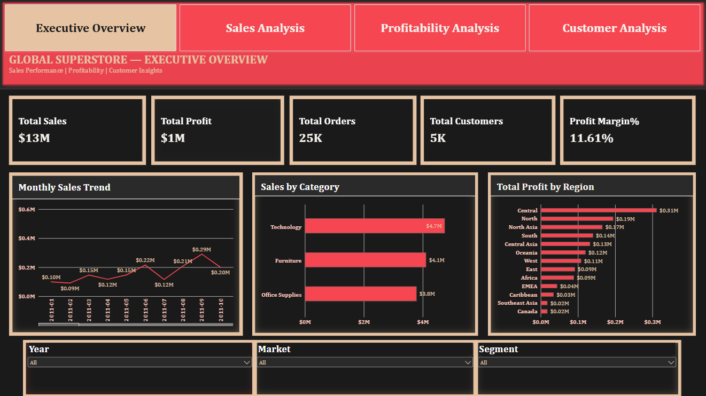
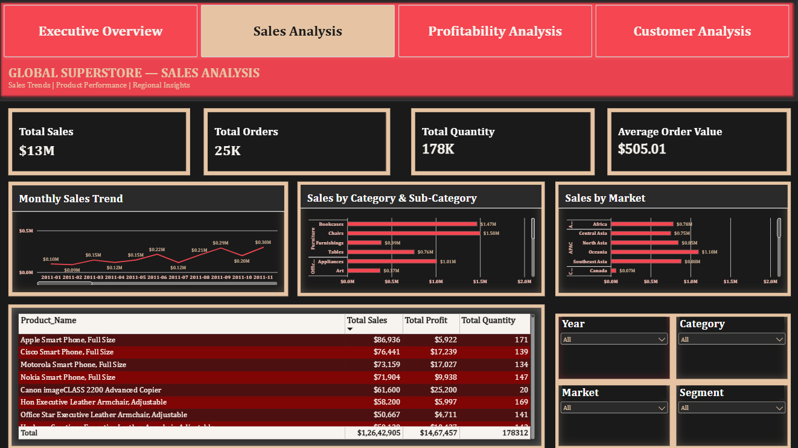
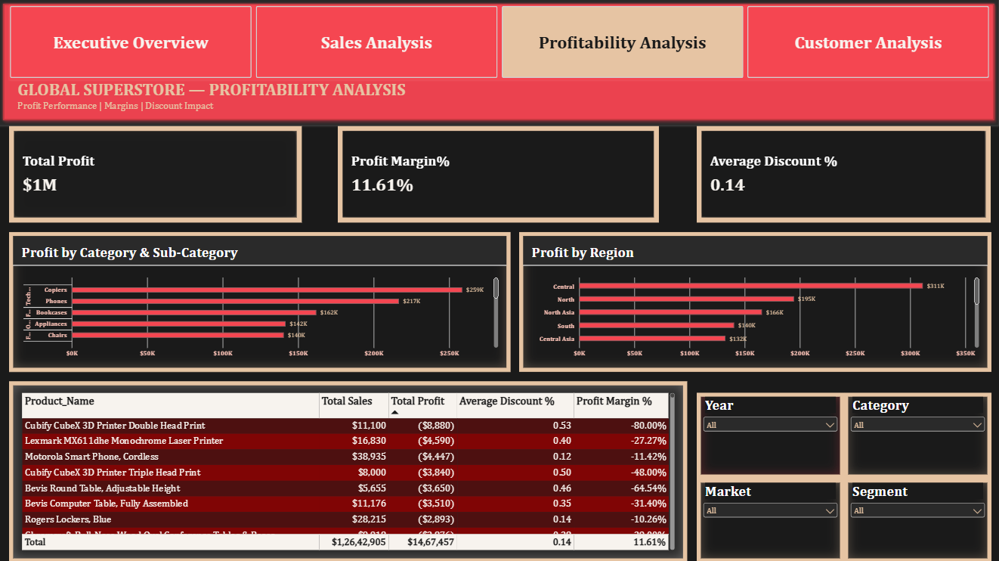
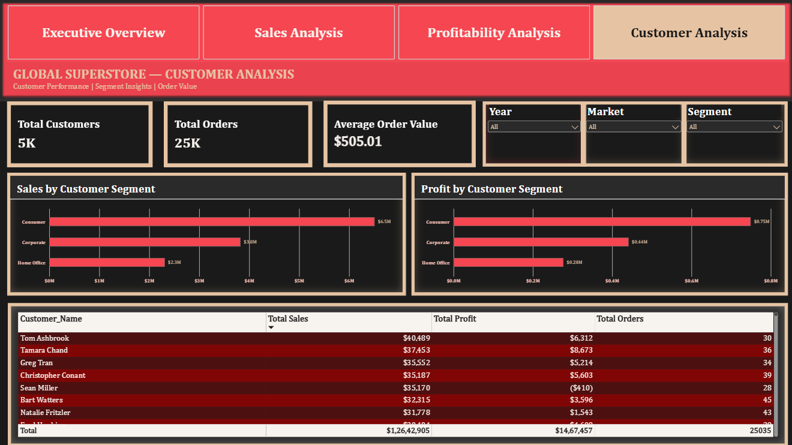

# 📊 Global Superstore Sales & Profit Analytics

**End-to-End Data Analytics Project | Python • SQL • Power BI • DAX**

An end-to-end data analytics project analyzing Global Superstore transactions to understand sales performance, profitability, product performance, customer segments, regional results, and discount patterns.

The project demonstrates a complete analytics workflow, from data inspection and cleaning to exploratory data analysis, SQL business analysis, DAX measure development, interactive dashboard creation, and business reporting.

**Core technologies:** Python · Pandas · NumPy · MySQL · Power BI · DAX · Jupyter Notebook · Git · GitHub

---

## 📌 Project Overview

Sales transaction data can reveal valuable insights into business performance, product demand, customer behavior, and profitability. However, meaningful analysis requires reliable data preparation, consistent metric definitions, and accurate calculations.

This project analyzes Global Superstore data using Python, SQL, and Power BI. The resulting four-page dashboard helps users explore sales trends, compare products and regions, investigate customer segments, and identify loss-making products.

The project focuses on descriptive business analytics and evidence-based insights rather than assuming that high sales automatically indicate high profitability.

## 🎯 Business Objectives

- Understand the structure and quality of the original dataset.
- Clean and validate transaction data while preserving the raw source.
- Analyze sales and profit performance over time.
- Compare performance across markets, regions, categories, and subcategories.
- Identify top-performing and loss-making products.
- Analyze customer segments and customer-level performance.
- Examine discount patterns and their relationship with profitability.
- Develop reusable Python scripts and SQL business queries.
- Build DAX measures and an interactive Power BI dashboard.
- Validate important metrics across Python, SQL, and Power BI.
- Document findings, limitations, and business recommendations.

## 🛠️ Tools & Technologies

| Technology | Application |
|---|---|
| Python | Data preparation and analysis |
| Pandas | Data manipulation and cleaning |
| NumPy | Numerical operations |
| Matplotlib | Data visualization |
| Seaborn | Exploratory visualization, where used |
| Jupyter Notebook | Reproducible analysis workflow |
| MySQL | SQL business analysis |
| MySQL Workbench | Query development and execution |
| Power BI Desktop | Interactive dashboard development |
| DAX | KPI measures and calculations |
| Git | Version control |
| GitHub | Project hosting and portfolio presentation |
| Antigravity | Project development and file organization |

## 📊 Power BI Dashboard Showcase

The Power BI report contains four pages with a consistent visual theme, KPI cards, charts, tables, slicers, and page navigation.

### 1. Executive Overview

Provides a high-level view of overall business performance.

**Key components**
- Total Sales
- Total Profit
- Total Orders
- Total Customers
- Profit Margin %
- Monthly Sales Trend
- Sales by Category
- Total Profit by Region
- Year, Market, and Segment slicers

**Purpose:** Summarize business performance and provide a starting point for further analysis.



### 2. Sales Analysis

Explores sales performance across products, markets, and time periods.

**Key components**
- Total Sales
- Total Orders
- Total Quantity
- Average Order Value
- Monthly Sales Trend
- Sales by Category and Subcategory
- Sales by Market
- Product performance table
- Year, Category, Market, and Segment slicers

**Purpose:** Identify sales trends, leading product categories, and high-performing markets.



### 3. Profitability Analysis

Examines profit performance and identifies areas requiring further investigation.

**Key components**
- Total Profit
- Profit Margin %
- Average Discount %
- Profit by Category and Subcategory
- Profit by Region
- Product profitability table
- Negative-profit product analysis
- Year, Market, Category, and Segment slicers

**Purpose:** Compare profitability across products and regions and investigate loss-making areas.



### 4. Customer Analysis

Compares customer performance and customer segment contributions.

**Key components**
- Total Customers
- Total Orders
- Average Order Value
- Sales by Customer Segment
- Profit by Customer Segment
- Customer performance table
- Year, Market, and Segment slicers

**Purpose:** Identify valuable customers and compare sales and profit across customer segments.



**Power BI report:** `dashboard/Global_Superstore_Analytics.pbix`

Open the PBIX file using Microsoft Power BI Desktop to explore the interactive report. The PNG files above are static screenshots and do not contain interactive functionality.

## 🔍 Analytical Questions

### Sales Performance
- What are the total sales and total profit?
- How do sales change month by month and year by year?
- Which categories and subcategories generate the most sales?
- Which markets and regions contribute most to sales?
- What is the average order value?

### Product Performance
- Which products generate the highest sales?
- Which products generate the highest profit?
- Which products have negative profit?
- How does product performance vary across categories?
- How do discounts relate to product profitability?

### Customer Analysis
- How many unique customers and orders are present?
- Which customers generate the highest sales?
- Which customer segments contribute the most sales?
- How does profit vary across customer segments?
- How does customer performance change under different filters?

### Profitability
- What is the overall profit margin?
- Which regions generate the most profit?
- Which products or subcategories show negative profit?
- Are high-sales products also highly profitable?
- How do average discounts differ across products and segments?

## 🧹 Project Workflow

### Business Understanding

Defined the project objectives, business questions, scope, and analytical requirements.

### Dataset Understanding

Inspected dataset dimensions, columns, data types, missing values, duplicate records, category distributions, and numerical summaries.

**Notebook:** `notebooks/01_data_understanding.ipynb`

### Data Cleaning

Prepared the transaction dataset, checked data quality, and produced a processed dataset for analysis.

**Notebook:** `notebooks/02_data_cleaning.ipynb`

**Reusable script:** `src/data_cleaning.py`

### Exploratory Data Analysis

Explored sales, profit, discounts, shipping, products, markets, and yearly performance using summary tables and charts.

**Notebook:** `notebooks/03_exploratory_data_analysis.ipynb`

### SQL Business Analysis

Developed SQL queries for basic analysis, sales performance, customer analysis, product analysis, and profitability.

**SQL files:**
- `sql/01_basic_analysis.sql`
- `sql/02_sales_analysis.sql`
- `sql/03_customer_analysis.sql`
- `sql/04_product_analysis.sql`
- `sql/05_profitability_analysis.sql`

### Phase 6 — Power BI Data Modeling and Dashboard Development

Created the data model, developed DAX measures, configured report relationships, and built four interactive report pages.

### Phase 7 — Validation and Documentation

Compared key metrics across Python, SQL, and Power BI and prepared project documentation and dashboard screenshots.

## 📁 Repository Structure

```text
Global-Superstore-Sales-Analytics/
├── dashboard/
│   ├── Global_Superstore_Analytics.pbix
│   ├── 01_executive_overview.png
│   ├── 02_sales_analysis.png
│   ├── 03_profitability_analysis.png
│   └── 04_customer_analysis.png
├── data/
│   ├── raw/
│   │   └── Superstore.csv
│   └── processed/
│       ├── superstore_cleaned.csv
│       ├── category_analysis.csv
│       ├── discount_analysis.csv
│       ├── market_analysis.csv
│       ├── shipping_analysis.csv
│       ├── subcategory_analysis.csv
│       └── yearly_performance.csv
├── images/
│   ├── category_sales.png
│   ├── discount_profit_margin.png
│   ├── monthly_sales.png
│   ├── region_profit.png
│   ├── shipping_mode.png
│   ├── yearly_profit.png
│   └── yearly_sales.png
├── notebooks/
│   ├── 01_data_understanding.ipynb
│   ├── 02_data_cleaning.ipynb
│   └── 03_exploratory_data_analysis.ipynb
├── reports/
│   └── project_report.md
├── sql/
│   ├── 01_basic_analysis.sql
│   ├── 02_sales_analysis.sql
│   ├── 03_customer_analysis.sql
│   ├── 04_product_analysis.sql
│   └── 05_profitability_analysis.sql
├── src/
│   └── data_cleaning.py
├── .gitignore
├── README.md
└── requirements.txt
```

This structure reflects the project files currently identified. Confirm the filenames before publishing; retain any additional files already present in your repository.

## 📈 Key Metrics

The earlier inspection of the dataset reported the following preliminary results:

| Metric | Earlier inspection result |
|---|---:|
| Transaction rows | 51,290 |
| Distinct orders | 25,035 |
| Distinct customers | 4,873 |
| Total Sales | 12,642,905 |
| Total Profit | 1,467,457.29 |
| Total Quantity | 178,312 |
| Profit Margin | Approximately 11.61% |
| Date range | 2011–2014 |

These figures are validation targets from an earlier inspection. Reconcile them with the final cleaned dataset and Power BI measures before treating them as final project findings. Confirm the dataset's currency convention before assigning a currency symbol.

## 💡 Business Recommendations

### 1. Monitor Sales and Profit Together

Evaluate sales and profit together instead of using revenue alone to assess business performance.

### 2. Investigate Loss-Making Products

Use the profitability dashboard to investigate products with negative profit and examine their sales, discounts, and other available transaction attributes.

### 3. Compare Regional Performance

Compare sales and profit across markets and regions to identify differences that warrant further analysis.

### 4. Review Discount Patterns

Examine how discount levels vary across products and categories and how those groups perform financially. Observed relationships do not, by themselves, establish causation.

### 5. Understand Customer Segments

Use customer-level and segment-level results to identify high-performing customers and compare segment contributions.

### 6. Maintain Data Quality

Preserve the original dataset, document data-cleaning decisions, and validate calculations whenever the source data or analysis changes.

## ✅ Data Quality and Validation

The project workflow includes checks for:

- Missing values and duplicate records.
- Column names and data types.
- Date and numerical field validity.
- Product and customer identifier consistency.
- Consistency of sales, profit, order, and customer calculations.
- Reconciliation between Python, SQL, and Power BI.
- Correct operation of dashboard slicers and navigation.

An identified product identifier may correspond to multiple product descriptions in the dataset. This should be investigated and handled appropriately in the data model rather than automatically deleting records.

## ⚠️ Dataset Limitations

- Findings depend on the quality and scope of the supplied dataset.
- The currency and source definitions should be confirmed before interpreting financial values.
- Historical performance does not guarantee future results.
- Negative profit requires further investigation before recommending operational changes.
- Customer performance analysis does not automatically measure customer lifetime value, retention, or churn.
- Observed relationships do not establish causation.

## 🧠 Skills Demonstrated

- Data cleaning and validation
- Python and Pandas
- Exploratory Data Analysis
- SQL querying and aggregation
- Business metric development
- Product and customer analysis
- Power BI data modeling
- DAX measures
- Interactive dashboard design
- Data visualization
- Business reporting and documentation
- Git and GitHub version control

## 🚀 How to Run the Project

### Prerequisites

- Python
- Jupyter Notebook
- MySQL and MySQL Workbench
- Microsoft Power BI Desktop
- Git

### 1. Clone the repository

```bash
git clone YOUR_GITHUB_REPOSITORY_URL
cd Global-Superstore-Sales-Analytics
```

Replace `YOUR_GITHUB_REPOSITORY_URL` with the URL of your actual GitHub repository.

### 2. Create a virtual environment

```bash
python -m venv .venv
```

Activate it in Windows PowerShell:

```powershell
.\.venv\Scripts\Activate.ps1
```

### 3. Install dependencies

```bash
python -m pip install -r requirements.txt
```

### 4. Prepare the dataset

Place the authorized source dataset at:

```text
data/raw/Superstore.csv
```

Confirm that the filename matches the path expected by your scripts.

### 5. Run data cleaning

```bash
python src/data_cleaning.py
```

Review the output and confirm that the processed dataset is generated correctly.

### 6. Explore the notebooks

Run the notebooks in the `notebooks/` folder in sequence. Review the code and update file paths if your local environment differs.

### 7. Execute SQL analysis

Open the SQL files in MySQL Workbench. Configure the database and import the appropriate dataset before executing queries.

### 8. Open the Power BI report

Open the following file in Microsoft Power BI Desktop:

```text
dashboard/Global_Superstore_Analytics.pbix
```

If Power BI reports a missing data source, update the source path to the location of the processed dataset and refresh the report.

**Data note:** Make sure the dataset is permitted to be shared before including it in a public repository. Do not upload confidential information or credentials.

## 👨‍💻 Author

**Ruban Kumar N**

Aspiring Data Analyst | Python | SQL | Power BI

GitHub: [rubankumar296-maker](https://github.com/rubankumar296-maker)

Project: Global Superstore Sales & Profit Analytics

---

*This project demonstrates an end-to-end data analytics workflow for learning and portfolio purposes. Final numerical findings and recommendations should be supported by validated analytical results.*
